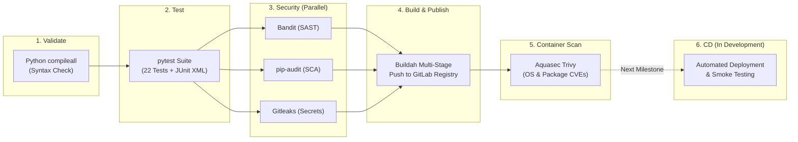
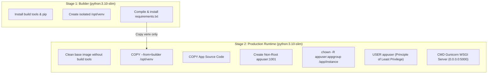

# 🚀 Employee Management System — Enterprise GitLab CI Pipeline & Container Security

[](https://gitlab.com/shindeakshay1211/employee-management-api/-/pipelines)
[](https://www.python.org/)
[](https://flask.palletsprojects.com/)
[](https://www.docker.com/)
[-purple)](https://buildah.io/)
[](https://github.com/aquasecurity/trivy)
[](https://gitlab.com/shindeakshay1211/employee-management-api/container_registry)

An enterprise-grade **Continuous Integration (CI) and Container Security pipeline** for a Python Flask REST API & Web Dashboard. 

This project demonstrates how to implement a secure, production-ready CI workflow using **GitLab CI/CD**: incorporating **multi-layered Shift-Left security scanning**, **daemonless rootless container builds with Buildah**, **container vulnerability auditing with Trivy**, and **immutable artifact publishing** to the GitLab Container Registry.

---

## 📌 Project Overview

This repository demonstrates the construction of an enterprise-grade CI pipeline for an Employee Management API.

### Implemented CI Capabilities
- **Automated Syntax Validation & Unit Testing:** Python `compileall` checks and 22 automated `pytest` test cases producing JUnit XML test reports.
- **Comprehensive Shift-Left Security:**
  - **SAST (Static Application Security Testing):** Code analysis with **Bandit**.
  - **SCA (Software Composition Analysis):** Dependency vulnerability scanning with **pip-audit**.
  - **Secret Detection:** Git commit and repository inspection with **Gitleaks**.
  - **Container Vulnerability Scanning:** Full OS and runtime CVE scanning with **Aquasec Trivy**.
- **Daemonless OCI Container Building:** Built using **Buildah** inside unprivileged Kubernetes SaaS runners (`gitlab--duo`) without requiring Docker-in-Docker (DinD) or root privileges.
- **Hardened Multi-Stage Docker Architecture:** 2-stage build separating Python virtualenv compilation (`/opt/venv`) from runtime, dropping root privileges to a dedicated non-root user (`appuser:1001`), and securing SQLite data persistence.
- **Immutable Container Registry Publishing:** Dynamic, zero-leak authentication using GitLab `$CI_JOB_TOKEN` and deterministic image tagging with `$CI_COMMIT_SHORT_SHA`.

---

## 🏗️ GitLab CI Pipeline Architecture

Every commit to `main` triggers a 5-stage automated pipeline executed across isolated Kubernetes runner pods:



---

## 🛡️ Shift-Left Security Matrix

Security gates are integrated into the pipeline to catch vulnerabilities early in the development lifecycle:

| Stage | Tool | Type | Target | Remediation & Configuration |
| :--- | :--- | :--- | :--- | :--- |
| **Security** | **Bandit** | SAST | Source code (`app.py`) | Enforced `debug=False` for production safety (remediated finding B201). |
| **Security** | **pip-audit** | SCA | `requirements.txt` | Isolated CI security tools from app dependencies; verified 0 CVEs. |
| **Security** | **Gitleaks** | Secret Scan | Git history & workspace | Scans for exposed API keys, private tokens, or credentials. |
| **Container Scan** | **Aquasec Trivy** | Container Security | Docker image | Analyzes Debian base OS and Python packages; DB cached in CI runner. |

---

## 🐳 Containerization: Hardened Multi-Stage Dockerfile

The container image is built using a **2-stage multi-stage Dockerfile** following enterprise container security best practices:



### Key Hardening Features:
1. **Minimal Attack Surface:** Compilers, pip cache, and temporary build files remain in Stage 1 and are not shipped to production.
2. **Non-Root Execution (`USER appuser`):** The application runs as non-privileged `appuser (UID 1001)`, mitigating container breakout risks.
3. **Least-Privilege Database Permissions:** SQLite instance directory ownership explicitly configured for `appuser:appgroup`.

---

## 📂 Project Structure

```text
employee-management-api/
├── .gitlab-ci.yml        # 5-stage GitLab CI pipeline definition
├── Dockerfile            # Production multi-stage, non-root Dockerfile
├── .dockerignore         # Strict context filter (ignores secrets, tests, caches)
├── .gitignore            # Git exclusion rules
├── pytest.ini            # Pytest discovery configuration
├── requirements.txt      # Production runtime dependencies (Flask, Gunicorn, etc.)
├── app.py                # Flask REST API backend & database initialization
├── instance/             # SQLite instance storage (company.db)
├── templates/
│   └── index.html        # Single-Page Application (SPA) dashboard UI
├── static/
│   ├── css/style.css     # Dark-themed dashboard styles
│   └── js/app.js         # Frontend AJAX logic & chart rendering
└── tests/
    └── test.py           # 22 automated unit & integration tests
```

---

## 🚀 Local Development & Execution

### Option 1: Running with Docker (Recommended)

```bash
# 1. Build the hardened multi-stage image
docker build -t employee-management-api:local .

# 2. Run container on port 5000
docker run -d -p 5000:5000 --name employee-api employee-management-api:local

# 3. Access in browser
http://localhost:5000/
```

### Option 2: Running Locally with Python Virtualenv

```bash
# 1. Create and activate virtual environment
python -m venv venv

# Windows:
.\venv\Scripts\activate
# Linux / macOS:
source venv/bin/activate

# 2. Install dependencies
pip install -r requirements.txt

# 3. Run unit tests
pytest -v

# 4. Start the application
python app.py
```

---

## 📊 REST API Reference

All API routes return JSON and include CORS support:

| Method | Endpoint | Description |
| :--- | :--- | :--- |
| `GET` | `/` | Web UI Single-Page Dashboard |
| `GET` / `POST` | `/api/employees` | List all employees / Create employee |
| `PUT` / `DELETE` | `/api/employees/<id>` | Update employee / Delete employee |
| `GET` / `POST` | `/api/departments` | List departments / Create department |
| `PUT` / `DELETE` | `/api/departments/<id>` | Update department / Delete department |
| `GET` / `POST` | `/api/projects` | List projects / Create project |
| `PUT` / `DELETE` | `/api/projects/<id>` | Update project / Delete project |
| `GET` / `POST` | `/api/dependents` | List dependents / Add dependent |
| `PUT` / `DELETE` | `/api/dependents/<id>` | Update dependent / Delete dependent |

---

## 🗺️ Project Status & Roadmap

- [x] **Stage 1 — Validate:** Python syntax verification via `compileall`
- [x] **Stage 2 — Test:** 22 automated unit tests with JUnit XML reporting
- [x] **Stage 3 — Security Scanning:**
  - [x] SAST code scanning with Bandit
  - [x] SCA dependency scanning with pip-audit
  - [x] Secret detection with Gitleaks
- [x] **Stage 4 — Build & Publish:**
  - [x] Hardened multi-stage Dockerfile with non-root user
  - [x] Rootless image building with Buildah on Kubernetes runners
  - [x] Immutable image publishing to GitLab Container Registry (`$CI_COMMIT_SHORT_SHA`)
- [x] **Stage 5 — Container Security:**
  - [x] Aquasec Trivy vulnerability scanning with CI cache
- [ ] **Stage 6 — Continuous Deployment (CD - Upcoming):**
  - [ ] Automated deployment trigger
  - [ ] Automated in-pipeline smoke tests
  - [ ] Release tagging and rollback strategy

---

## 👤 Author & Repositories

**Akshay Shinde**  
- **GitHub Repository:** [akshayshinde1211 / employeeManagementSystem](https://github.com/akshayshinde1211/employeeManagementSystem)  
- **GitLab CI Repository:** [shindeakshay1211 / employee-management-api](https://gitlab.com/shindeakshay1211/employee-management-api)  
- **GitLab Container Registry:** `registry.gitlab.com/shindeakshay1211/employee-management-api`
